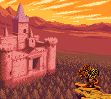
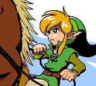

# Oracle of Ages & Oracle of Seasons — Static Recompilation

> *Two sister games. One shared runtime. Zero emulators.*

Static recompilations of **The Legend of Zelda: Oracle of Ages** and **The Legend of
Zelda: Oracle of Seasons** (Game Boy Color, 2001) — the entire ROM lifted into native
C code that runs directly on your CPU. No interpreter loop, no JIT, no per-instruction
fetch/decode at runtime. Just the game, recompiled, as if Capcom had shipped it
for Windows in 2001 instead of for a 4 MHz handheld.

## The Pitch

Released the same day, the Oracle games are arguably Capcom Flagship's most ambitious
Game Boy work — two parallel adventures (Ages = time-travel puzzles, Seasons =
season-shifting action) connected by a passwords system that lets a finished cartridge
unlock a linked sequel on the other. Same engine, different worlds. So they get the
same treatment here: one monorepo, two binaries, one shared runtime.

## Screenshots

| Oracle of Ages | Oracle of Seasons |
|:---:|:---:|
|  |  |
| *intro cinematic — the castle at sunset* | *intro cinematic — Link rides out* |
|  |  |
| *boot — Capcom Flagship logo* | *boot — Capcom Flagship logo* |

All 160×144 framebuffer dumps from the recompiled binaries (`--dump-frames`),
converted to PNG. Both games now boot through the publisher logos and play
their opening cinematics — see the "Boot stall, solved" note below.

## Status

| Stage                                | Ages | Seasons |
|--------------------------------------|:----:|:-------:|
| ROM acquired (your own copy, gitignored) | ✅ | ✅ |
| Project scaffolded                   |  ✅  |   ✅    |
| Recompiler bootstrapped (`gbrecomp`) |  ✅  |   ✅    |
| Recompiled to C (~3M lines each)     |  ✅  |   ✅    |
| First successful native build        |  ✅  |   ✅    |
| SDL window opens, framebuffer renders|  ✅  |   ✅    |
| Cartridge header recognized          |  ✅  |   ✅    |
| Boots past publisher logos           |  ✅  |   ✅    |
| Plays opening cinematic              |  ✅  |   ✅    |
| Reaches title screen                 |  🛠️  |   🛠️    |
| Reaches first dungeon                |  ⏳  |   ⏳    |
| Save / load to SRAM                  |  ⏳  |   ⏳    |
| Linked-game passwords verified       |  ⏳  |   ⏳    |
| Audio (4 channels, 44.1 kHz)         |  ⏳  |   ⏳    |
| Full playthrough                     |  ⏳  |   ⏳    |

> ⚙️ **Update — both games boot and play their intros!** `gbrecomp` translated
> both ROMs to native C on the first try (~86–89 MB of generated `.c` each,
> ~13.5k functions, ~92k basic blocks). After three CMakeLists tweaks
> (path, missing runtime sources, `LA_HAS_IMGUI`) and **one real runtime bug
> fix** (serial-port emulation — see below), `oracle_of_ages.exe` (21.7 MB)
> and `oracle_of_seasons.exe` (22.0 MB) now boot through the Nintendo /
> Capcom logos and play their opening cinematics: the castle at sunset
> (Ages) and Link riding out (Seasons), both in full GBC color with
> 44.1 kHz audio.

## Solved: the boot-logo stall

The first real bug, and a fun one to track down. Both games booted, rendered
the Capcom Flagship logo from a genuine framebuffer, ran every interrupt
handler correctly… and then froze on the logo forever. Here's the trail:

1. **The logo→title transition is gated by a countdown.** A 16-bit timer in
   WRAM (`$cbb3`) is decremented once per frame; when it hits zero the boot
   state machine advances (`$c2e7`: 1→2) and sets flag `$ffb9`, kicking off
   the intro. In a reference emulator (PyBoy) the timer initializes to
   `0x00D0` and cleanly counts to zero around frame 300.

2. **Our timer never reached zero.** Instrumenting the runtime showed the
   timer's *high* byte was `0x09` instead of `0x00`, so it would have taken
   ~2500 frames — and it got reloaded before then anyway. The init code at
   `3:4d56` correctly wrote `0x00D0`, but a single instruction at `3:4cd3`
   (`LD ($cbb4),$09`) kept clobbering the high byte right back.

3. **That clobber is gated by `$ffba`.** The game only runs the clobber when
   `$ffba != 0`. In PyBoy `$ffba` stays `0`; in our build it was non-zero.

4. **`$ffba` is the serial link-cable handshake byte.** The boot code probes
   the Game Link port: it sends `0xe1`/`0xe0` and, if it *reads the same
   bytes back*, concludes a second Game Boy is connected and enters link
   mode — which is what corrupted the logo timer.

5. **The runtime's serial emulation was the culprit.** On a write to `FF02`
   with the transfer-start bit set, the fallback handler raised the serial
   interrupt but never updated `FF01` — so the game read back *the very byte
   it had just sent* and mistook the open bus for a real peer. On actual
   hardware with no link cable, an internal-clock transfer clocks in `0xFF`
   from the floating data line.

**The fix** (`gbrecomp/runtime/src/gbrt.c`): on an internal-clock serial
transfer with no peer, set `FF01 = 0xFF`, raise the interrupt, and clear the
start bit; leave external-clock transfers pending (no peer, no clock). One
clean write of `0xFF` and both Oracles sail past the logo into their intros.

## Known Issues

- **Title-screen / gameplay not yet verified.** The intro cinematics play;
  full progression to the file-select screen, gameplay, and the linked-game
  password system still needs testing.

*Updated as the work progresses — this section is the source of truth.*

## How It Works

This repo holds two thin game-specific wrappers (one `CMakeLists.txt` per game)
that share a single recompiler runtime via the `gbrecomp/` submodule. The
recompiler emits `oracle_of_<game>.{c,h}`, `_rom.c` (ROM bytes as a C array),
and `_main.c` (entrypoint) into each game's directory.

```
                        your own ROMs (never committed)
                   roms/oracle-of-ages.gbc      roms/oracle-of-seasons.gbc
                              │                              │
                              ▼                              ▼
              ┌──────────────────────────────────────────────────────┐
              │   gbrecomp/recompiler/    (sp00nznet/gb-recompiled)  │
              │   SM83 → C translation, ROM-as-array, headers        │
              └──────────────────────────────────────────────────────┘
                              │                              │
         ages/oracle_of_ages.{c,h,_main.c,_rom.c}   seasons/oracle_of_seasons.{c,h,_main.c,_rom.c}
                              │                              │
                              ▼                              ▼
              ┌────────────────────────┐    ┌────────────────────────┐
              │   ages/CMakeLists.txt  │    │ seasons/CMakeLists.txt │
              │   + shared gbrt        │    │   + shared gbrt        │
              └────────────────────────┘    └────────────────────────┘
                              │                              │
                              ▼                              ▼
                       oracle_of_ages.exe              oracle_of_seasons.exe
```

The heavy lifting (SM83 CPU model, scanline PPU with full CGB color, MBC5 mapper,
APU, SDL2 platform layer, ImGui debug overlay) all lives in
[**`sp00nznet/gb-recompiled`**](https://github.com/sp00nznet/gb-recompiled) — the
same runtime that powers the Pokémon Gold / Crystal and Link's Awakening DX recomps.

## Building

### Prerequisites

- Windows 10/11
- MSYS2 with MinGW64:
  `pacman -S mingw-w64-x86_64-toolchain mingw-w64-x86_64-cmake mingw-w64-x86_64-ninja mingw-w64-x86_64-SDL2`
- Legally-obtained Oracle of Ages and/or Oracle of Seasons ROMs (`.gbc`)

### One-time setup

```bash
git clone --recurse-submodules https://github.com/sp00nznet/oracle-recompiled.git
cd oracle-recompiled
```

If you forgot `--recurse-submodules`:

```bash
git submodule update --init --recursive
```

### Generate the C output for each game

See the [gb-recompiled README](https://github.com/sp00nznet/gb-recompiled) for the
exact recompiler invocation. Drop your ROMs into `roms/` and point the tool at them:

```bash
# First, build the recompiler tool itself (only needed once)
cd gbrecomp && mkdir -p build && cd build && cmake -G Ninja .. && ninja && cd ../..

# Oracle of Ages
./gbrecomp/build/bin/gbrecomp.exe roms/oracle-of-ages.gbc -o ages/

# Oracle of Seasons
./gbrecomp/build/bin/gbrecomp.exe roms/oracle-of-seasons.gbc -o seasons/
```

This produces, per game, `oracle_of_<game>.c` (~85 MB), `oracle_of_<game>_rom.c`
(~6 MB ROM bytes as a C array), `oracle_of_<game>.h`, `oracle_of_<game>_main.c`,
and a fresh `CMakeLists.txt`. **All five are gitignored** — only the
hand-curated `CMakeLists.txt` patch (one line, fixes the runtime path for our
monorepo layout) is committed via a tracked override in this README's "Layout
caveat" below.

> **Layout caveat.** The recompiler auto-generates a `CMakeLists.txt` per
> game that's correct in shape but needs two tweaks for this layout, both
> already applied in the committed CMakeLists files (so a regeneration
> from a clean ROM checkout will overwrite them — re-apply if you do):
>
> 1. **Runtime path** — auto-gen assumes the output sits at
>    `gbrecomp/<game>/`, so `GBRT_DIR` points to `../../runtime`. We need
>    `../gbrecomp/runtime`:
>    ```bash
>    sed -i 's|../../runtime|../gbrecomp/runtime|' \
>      ages/CMakeLists.txt seasons/CMakeLists.txt
>    ```
> 2. **Missing runtime sources** — `platform_sdl.cpp` in the runtime calls
>    into `menu_gui_*`, `asset_viewer_*`, and `hwtrace_*`, but auto-gen
>    only adds `gbrt.c`, `ppu.c`, `audio.c`, `interpreter.c`, and
>    `platform_sdl.cpp`. Without the other three you get undefined-symbol
>    link errors. Add to the `add_library(gbrt STATIC ...)` block:
>    ```
>    ${GBRT_DIR}/src/hwtrace.c
>    ${GBRT_DIR}/src/menu_gui.cpp
>    ${GBRT_DIR}/src/asset_viewer.cpp
>    ```
>    and add `${GBRT_DIR}/src` to `target_include_directories`.

### Build

```bash
PATH="/c/msys64/mingw64/bin:$PATH"

# Ages
cmake -S ages -B ages/build -G Ninja
cmake --build ages/build           # ~3M lines of C → expect a long compile
./ages/build/oracle_of_ages.exe

# Seasons
cmake -S seasons -B seasons/build -G Ninja
cmake --build seasons/build
./seasons/build/oracle_of_seasons.exe
```

## Expected ROM Hashes

These are the (U) [C][!] revisions — the ones the recompiler is being targeted against.

| Game              | SHA-1                                      | MD5                                |
|-------------------|--------------------------------------------|------------------------------------|
| Oracle of Ages    | `880374fb978b18af4aa529e2e32f7ffb4d7dd2f4` | `c4639cc61c049e5a085526bb6cac03bb` |
| Oracle of Seasons | `ba1268290fb2b1b70505d2d7b5825fc8a4816a4b` | `f2dc6c4e093e4f8c6cbea80e8dbd62cb` |

Both are 1,048,576 bytes (1 MB), MBC5+RAM+BATTERY, CGB-only.

## Repository Layout

```
.
├── README.md                  # this file
├── .gitmodules                # gbrecomp submodule pointer
├── .gitignore                 # blocks ROMs and generated rom.c artifacts
├── gbrecomp/                  # shared submodule → sp00nznet/gb-recompiled
├── roms/                      # gitignored — drop your own ROMs here
├── ages/
│   ├── CMakeLists.txt              # regenerated by gbrecomp; one-line path fix needed
│   ├── oracle_of_ages.h            # generated, gitignored
│   ├── oracle_of_ages.c            # generated, gitignored (~86 MB)
│   ├── oracle_of_ages_main.c       # generated, gitignored — entrypoint
│   └── oracle_of_ages_rom.c        # generated, gitignored (~6 MB ROM-as-C-array)
├── seasons/                        # same shape as ages/, with oracle_of_seasons_*
│   └── …
└── screenshots/
```

## A Note on the Linked-Game Passwords

The Oracles can talk to each other. A finished Seasons cart hands the player a
password that, typed into a fresh Ages save, opens a continuation story — and
vice versa. Two binaries, one save world. Verifying that handshake works
end-to-end across the recompiled builds is a milestone in the status table above
and possibly the most fun this project will produce.

## Legal

This repository contains **zero copyrighted Nintendo or Capcom material**.

- No ROM bytes, no decompiled sources, no assets, no audio, no sprites.
- The recompiler's output (`rom.c`, `rom_rom.c`, `rom.h`) is gitignored and
  **must be regenerated locally** from your own legally obtained ROM.
- Everything checked in is original glue code (MIT) or a pointer to a public
  upstream (the `gbrecomp` submodule).

This is a personal preservation and education project. Don't redistribute ROMs.

## Credits & Acknowledgements

- **Games** — Nintendo / Capcom Flagship (Oracle of Ages & Oracle of Seasons, 2001)
- **Recompiler** —
  [arcanite24/gb-recompiled](https://github.com/arcanite24/gb-recompiled)
  with CGB fixes, runtime extensions, and SDL2 frontend in
  [sp00nznet/gb-recompiled](https://github.com/sp00nznet/gb-recompiled)
- **Reference emulator** — [SameBoy](https://github.com/LIJI32/SameBoy) by LIJI32
- **Frontend** — [Dear ImGui](https://github.com/ocornut/imgui) + [SDL2](https://www.libsdl.org/)
- **Disassembly references** (for triage only, not build inputs) —
  [oracles-disasm](https://github.com/stewmath/oracles-disasm) by stewmath et al.
- **Prior art in the sp00nznet recomp family** —
  [pokemon-gold](https://github.com/sp00nznet/pokemon-gold) ·
  [pokemon-crystal](https://github.com/sp00nznet/pokemon-crystal) ·
  [LinksAwakening](https://github.com/sp00nznet/LinksAwakening)
